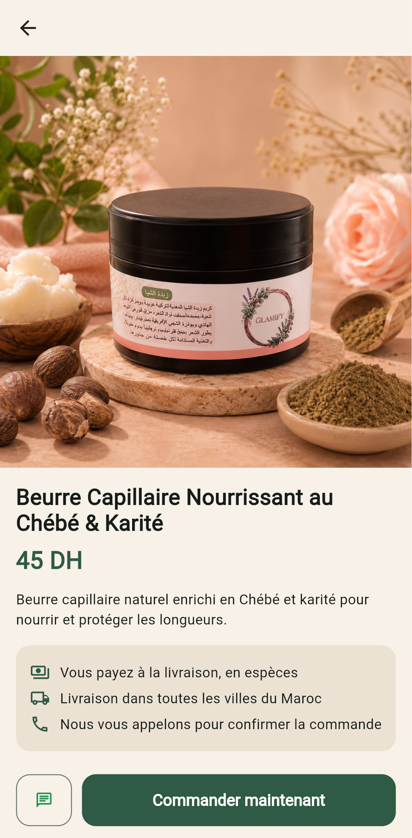
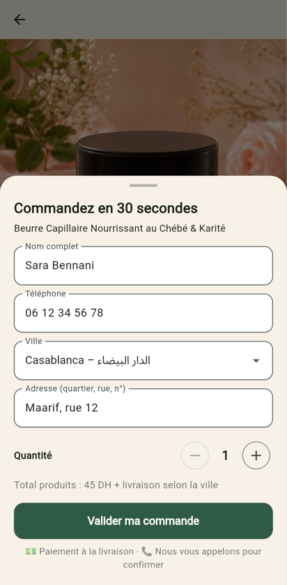
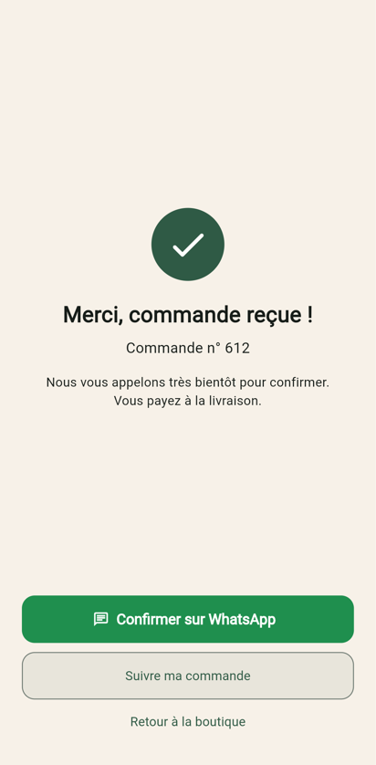
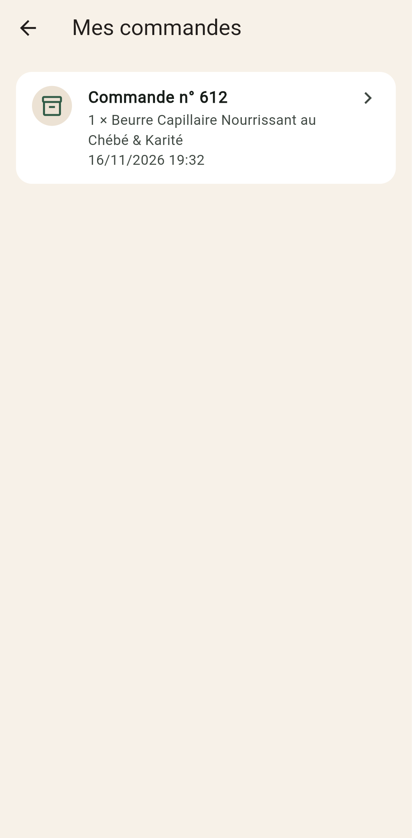
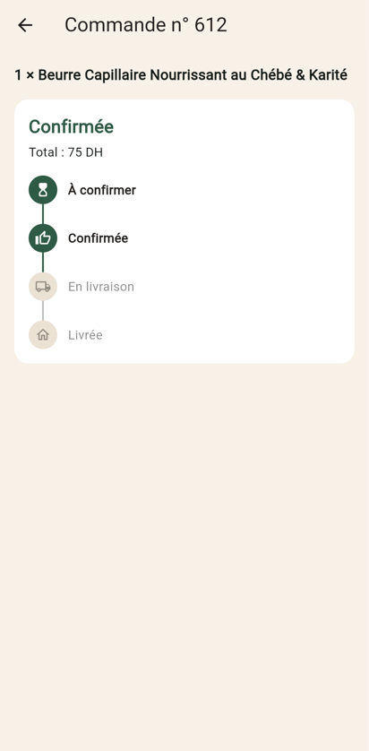

# Glamifyy — mobile shop app (Flutter)

Android & iOS app for [glamifyy.shop](https://glamifyy.shop), a Moroccan natural hair-care store
that sells with **cash on delivery**. Customers browse the catalogue and order in about 30 seconds
(name, phone, city, address), then follow their order.

| Home | Product | Order | Confirmation | My orders | Tracking |
| --- | --- | --- | --- | --- | --- |
|  |  |  |  |  |  |

## Features

- **Live catalogue** from the WooCommerce **Store API** (public, so no secret keys ship in the app).
- **One-step COD order** through the Maroc Checkout Pro quick-order endpoint: same phone
  validation, shipping rate per city, risky-customer check and "to confirm" status as the website.
- **60 Moroccan cities** (French + Arabic), Moroccan phone validation mirrored from the plugin.
- **Order tracking** by order number + phone (`/wp-json/mcwcp/v1/track`, Maroc Checkout Pro 0.6.0+),
  with a WhatsApp fallback.
- **WhatsApp** buttons with pre-filled messages.
- **Push notifications** for promotions (Firebase Cloud Messaging, topic `promos`) — see [docs/PUSH.md](docs/PUSH.md).

## Stack

Flutter 3.50 · Dart 3.14 · Riverpod 3 · go_router · Dio · shared_preferences · Firebase Messaging

```
lib/
  core/       config, theme, money, phone, text helpers
  data/       models, Store API, order API, local storage, providers, cities
  features/   catalog, product, order, orders (tracking)
  services/   WhatsApp, push notifications
test/         unit tests (phone, prices, HTML decoding, API parsing, statuses)
tool/mock/    local mock of the shop API for UI checks
```

## Run

```bash
flutter pub get
flutter test
flutter run                      # against https://glamifyy.shop
```

Offline demo with the local mock server:

```bash
flutter build web --dart-define=API_BASE=http://127.0.0.1:8080
python3 tool/mock/server.py 8080   # then open http://127.0.0.1:8080
```

CI (GitHub Actions) runs `analyze`, `test` and builds a release APK on every push to `main`
(download it from the workflow run's **Artifacts**).

## Author

Omar Elkazini — Flutter & Django developer, Casablanca.
